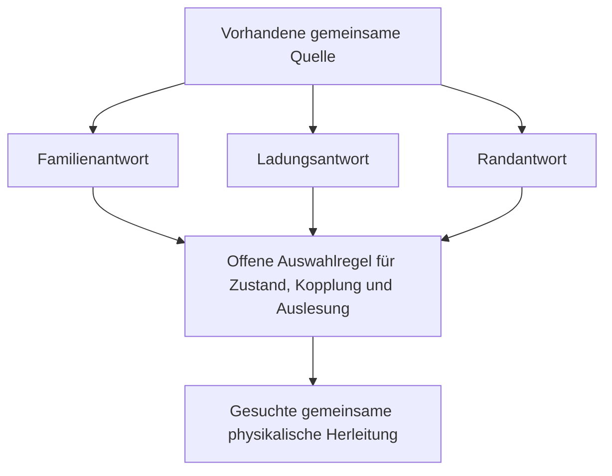

# TFPT: Ergebnis der automatischen Regelsuche

**Die erste konkrete Suche ist ausgeführt. Eine vollständige gemeinsame Ursprungsregel wurde dabei nicht gefunden.** Es gibt einen exakten Übersetzungskandidaten zwischen Feld- und Randantwort. Die gemeinsame Prüfung zeigt aber, welche zusätzlichen Auslese- und Kopplungsentscheidungen dieser Kandidat noch braucht.

Stand: 30.09.2026. Forschungs-ID `UR.SOURCE.RULE_SEARCH.01`, Verdict **PARTIAL**. Ausgangsstand des Repositories: `d44f1040d733338e1c0596433b5b2578d7c00295`.

## Einfach und bildlich

Stell dir die vorhandene Quelle als ein Instrument vor. Wir können an ihm verschiedene Töne abnehmen: eine Familienantwort, eine Ladungsantwort und eine Antwort am Rand. Die Suche prüft, ob ein kurzer gemeinsamer Bauplan diese Abnahmen verbindet.

Ein kurzer Übersetzer wurde gefunden. Doch wenn wir ihn an alle Töne zugleich anschließen, ergibt sich noch nicht automatisch die gesuchte Alpha-Antwort. Getrennte Abnahmen derselben Quelle sind rechnerisch verträglich. **Der fehlende Bauplan muss erklären, warum gerade diese Abnahmen und ihre Kopplung entstehen.**

Die Skizze zeigt den untersuchten Anschlussweg. Die letzte Auswahlregel ist offen; die Pfeile dorthin sind kein Herkunftsbeweis.

## Was tatsächlich gesucht wurde

Die Suche verwendet die vorhandenen TFPT-Quelloperatoren. Das finite Q/P-Wörterbuch und die bereits geprüfte Auswahl von eta=-3 sind Ausgangsbedingungen, kein neuer Sucherfolg. Die Suche setzt bei ihrem noch offenen Anschluss an die gemeinsame Quellenantwort an.

| Suchklasse | Ausgeführt | Ergebnis |
|---|---:|---|
| Kurze Modenfilter aus Potenzen von n, n−1 und n+1 | 37.349 Kandidaten, exakt | Ein eindeutiger positiver Treffer in dieser Klasse |
| Reine Potenzfilter aus n | 221 Kandidaten plus Klassenbeweis | Kein Treffer; auch außerhalb dieses endlichen Fensters ausgeschlossen |
| Einzelner neutraler Operator aus den vorhandenen Richtungen R und RY | 8.649 rationale Koeffizientenpaare plus Beweis für alle reellen Paare | Kein Treffer unter den ausdrücklich gesetzten gemeinsamen Bedingungen |
| Gemeinsame Marken-, Referenz- und Zeitprüfung des gefundenen Filters | Exakte Rechnung | Bedingter Randtreffer; dieselbe vollständige Turmauslesung ergibt keinen einzelnen Grad2-Zeitfaktor |

Das ist eine begrenzte exakte Bruteforce-Suche mit anschließenden Strukturbeweisen. Ein genetischer Algorithmus wurde in diesem Durchgang nicht eingesetzt. Eine Suche über beliebige Gesetze oder alle möglichen Kopplungsoperatoren wurde damit nicht geleistet.

## Der exakte Treffer

Der vorhandene neutrale Quellzustand R hat Normquadrat 48. Seine Moden haben die Gewichte

\[
\kappa_n=8n(n^2-1),\qquad n\ge2.
\]

Gesucht wurde ein Filter, der daraus die logarithmischen Randgewichte 1/n macht. In der vorgegebenen Klasse liefert exakt

\[
s_n=\frac1{\sqrt{8n^2(n^2-1)}}
\quad\Longrightarrow\quad
\kappa_ns_n^2=\frac1n.
\]

Diese Identität gilt für alle aktiven Moden, nicht nur für einige angepasste Zahlen. Bei vier gewählten Kreispositionen stimmt die gerade Randprojektion mit der vorhandenen Mark-Green-Antwort überein, **wenn beide denselben Diagonal-Referenzabzug verwenden**. Dieser Referenzabzug und die Feld-zu-Rand-Abbildung wurden hier als Vergleichsannahmen eingesetzt; ihre Auswahl aus P1 wurde nicht hergeleitet.

Der Treffer ist deshalb eine exakte Übersetzung, noch kein Ursprungsgesetz.

## Warum dieser Treffer noch nicht alles verbindet

Die Alpha-Kandidatenform enthält einen einzelnen Zeitfaktor e^(−2 alpha). Der vollständig gefilterte Modenturm enthält jedoch weitere positive Zeitbeiträge. Die skalare Viermarkenabnahme beginnt bei Graden 4 und 8; die Abnahme des Gewicht2-Feldes beginnt bei 2 und 6. Keine dieser vollständigen Abnahmen ist für alle positiven Zeiten nur eine feste Konstante mal e^(−2 alpha).

Eine separate Projektion auf den vorhandenen Grad2-Zustand liefert dagegen exakt 48 e^(−2 alpha). Sie ist ein positiver Kontrollfall: **Verschiedene Auslesungen derselben Quelle sind weiterhin möglich.** Offen ist ihre gemeinsame Auswahl aus den Ursprungsprinzipien. Auch die Identifikation von alpha mit dieser Sewing-Zeit bleibt hier eine zusätzliche Annahme.

## Familienantwort und Ladungsantwort

Die tatsächliche Quellwurzelrechnung wurde neu ausgeführt. Sie bestätigt zwei vorhandene unabhängige Richtungen:

\[
R_Y=\frac5{24}R+S_Y,\qquad
\operatorname{Gram}(R,S_Y)=\operatorname{diag}(48,115/12).
\]

R hat im geprüften JY-JY-Korrelator keine Hyperladungsantwort; SY trägt diese Antwort. Das sind unterschiedliche Antworten derselben Quelle. Ihre erneute Berechnung ist keine neue Entdeckung der Quellenstruktur und noch keine physikalische Photon-Herleitung.

Für einen einzelnen Operator F=aR+bRY wurde die konkrete Hypothese geprüft: unveränderte Familienkomponente 1, Normquadrat 48 und nichtverschwindende Hyperladungsantwort. Unter der ersten Bedingung gilt

\[
\|F\|^2=48+\frac{115}{12}b^2.
\]

Norm48 erzwingt somit b=0, und dann verschwindet die geprüfte Ladungsantwort. Das schließt diese Klasse für alle reellen Koeffizienten aus. **Es beweist nicht, dass ein allgemeiner physikalischer Vertex dieselbe Normbedingung erfüllen müsste**, und schließt weder andere Operatoren noch getrennte Auslesungen aus.

## Was der nächste Anschluss leisten muss

Der nächste gemeinsame Suchgegenstand ist die ursprüngliche geladene Rand-/Collarregel mit ihrem Zustand und ihrer Kopplung. Sie muss die vorhandene Familienverbindung, die geladene Korrelatorantwort und die Alpha-Randauslesung zugleich auswählen, einschließlich Zeit- und Referenzbezug. Die vorhandene Ausgangsform des Collar-Operators enthält dafür noch keine aus P1/P2 ausgewählte vollständige geladene Operatorabhängigkeit.

Ein größeres Koeffizientengitter in den hier ausgeschlossenen Klassen löst diese Auswahlfrage nicht. Der gefundene Filter und die zwei Quellenrichtungen bleiben konkrete Anschlussbedingungen für die weitere Suche. Massenkopplungen, die physikalische 3+1D-Abbildung und die vollständige Ursprungsherleitung bleiben offen.

## Nachprüfbarkeit

Die Rechnungen wurden nach Zusammenführung erneut ausgeführt. Dabei wurden die ursprünglichen Quellwurzelmomente und Paarantworten neu berechnet und die R-Zustandsnorm mit der Laurent-Modennorm verglichen. Alle ausführbaren mathematischen Kontrollen bestanden. Das bestätigt die obigen Befunde innerhalb ihres Geltungsbereichs, keinen physikalischen Abschluss.

Der Suchstand ist im TFPT-Projekt als `source-rule-search-20260930` mit Verdict PARTIAL gespeichert und im Theoriegraphen auffindbar. Der Graphcheck bestand; bestehende Warnungen zu anderen Manifesten und Abhängigkeitszyklen bleiben bestehen. Verifikationssuite, Ledger und Papers wurden nicht verändert; aktualisiert wurden der neue Forschungsordner und die daraus erzeugten Theoriegraph-Dateien.

Das beiliegende Rechenpaket enthält die drei Suchrechnungen, Beweise, Ergebnisse und einen gemeinsamen Aufruf. Es benötigt das vorhandene TFPT-Repository; Quellhashes sind in `results/summary.json` dokumentiert.

Originalquellen: `tfpt_explorer/neutral_source_response.py`, `source_charge_response.py`, `source_majorana_pairs.py`, `source_flavor_correlator.py`; vorhandene Contracts `source-flavor-joint-dictionary-20260921`, `source-native-clock-flavor-bridge-20260922`, `source-variation-origin-gate-20260922`.
